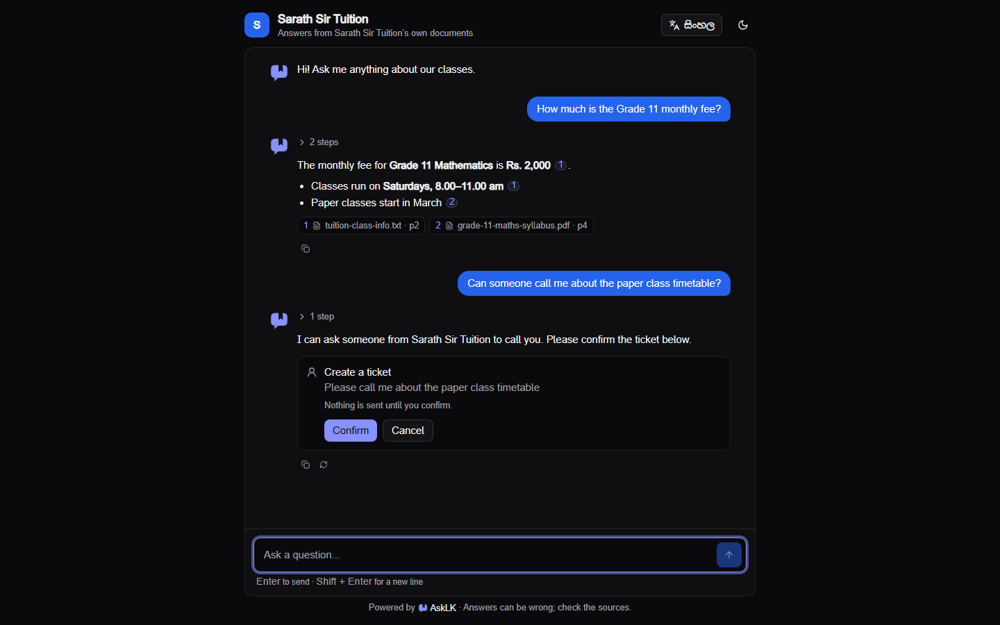
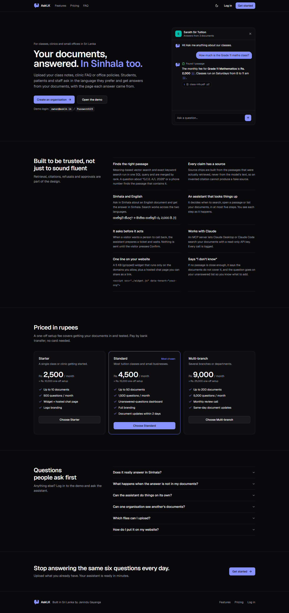
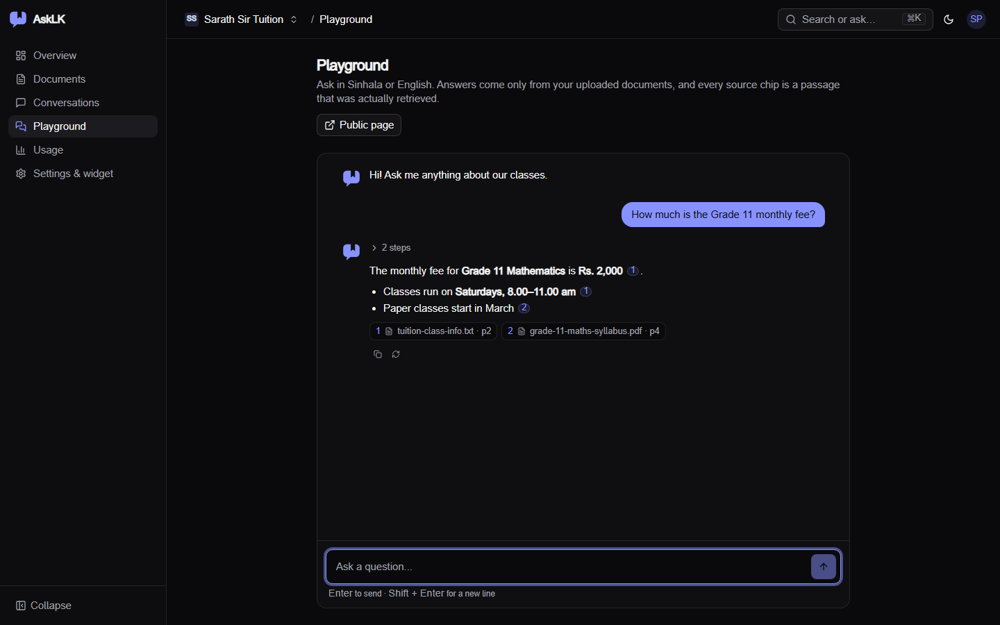
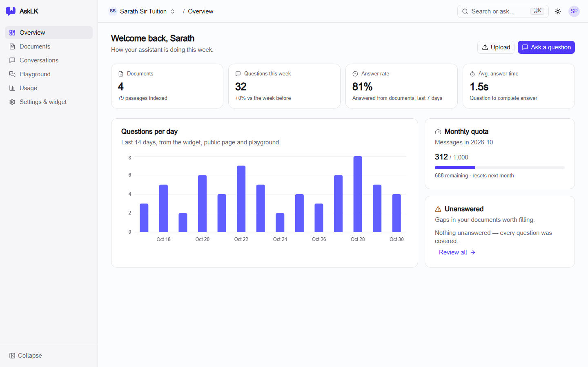
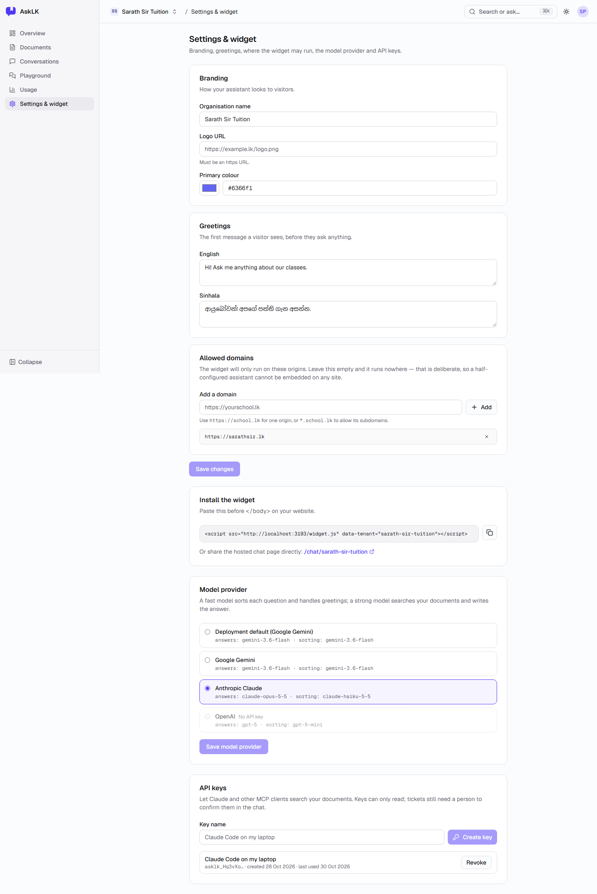
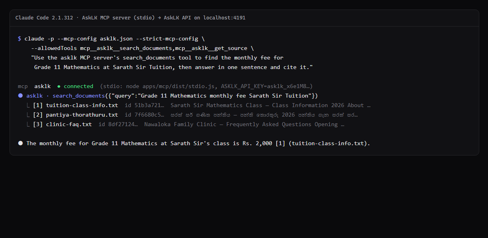

# AskLK

**Full source: [github.com/jani358/asklk-ai-assistant](https://github.com/jani358/asklk-ai-assistant)**

A white-label AI assistant that a Sri Lankan organisation can point at its own documents. A tuition
teacher uploads notes and past papers and students ask questions. A clinic uploads its FAQ and patients
ask about services. Ask in Sinhala and you get Sinhala, even when the document is in English.

This repo started as the public face of a private project. The main repo is public now, so this is a
short tour with a few excerpts. Everything is in the main repo, including the tests.

Janindu Gayanga · [iamjanindu.com](https://iamjanindu.com) · [LinkedIn](https://www.linkedin.com/in/janindu-gayanga-02ba60217) · janindugayanga10@gmail.com

## What it does

- Upload PDFs, Word files or text. They're extracted, chunked and embedded in the background, with a
  readable reason when something fails (a scanned PDF with no text, for example).
- Answers stream over SSE with inline citations. The source cards come from the retrieved rows, not
  from the model's text.
- A tool-calling agent can search, read a passage, list documents and open a support ticket. It stops
  after five steps, and anything that writes data waits for the user to confirm.
- Each organisation picks Gemini, Claude or an OpenAI-compatible model. A fast model classifies and a
  stronger one answers.
- An MCP server (stdio and streamable HTTP) lets Claude search an organisation's documents with a
  tenant API key. I ran it from Claude Code against a local API; that's the last screenshot below.
- An embeddable widget in vanilla TypeScript inside a Shadow DOM: 17 KB raw, 5 KB gzipped.

## Screenshots

| | |
|---|---|
|  Landing page |  Playground: tool steps and citations |
|  Dashboard |  Model provider and API keys |

## How retrieval works

Two queries, merged in TypeScript. A pgvector cosine query finds passages that mean the same thing,
which is what lets a Sinhala question match an English passage at all. A Postgres full-text query
finds the exact tokens embeddings are bad at, like "G.C.E. A/L 2026" or a phone number. The two lists
are merged with reciprocal rank fusion, by rank rather than score, because a cosine similarity and a
`ts_rank` can't be added up. A passage ranked 3rd in both lists beats one ranked 1st in only one.

Both queries filter on `tenantId` inside the SQL, and the vectors live in the same database as the rows,
so the tenant pre-filter and the similarity search are one statement each. On top of that, Postgres
row-level security runs through a scoped app role, so a missing `WHERE` is caught by the database too.

The embeddings are `gemini-embedding-001` at 768 dimensions, not the default 3072, because pgvector's
HNSW index tops out at 2000 dimensions. A 3072-d column can be stored but never indexed.

[`samples/rag-hybrid-search/`](samples/rag-hybrid-search/)

## Not making things up

Four layers. A similarity floor makes the bot refuse before the model is ever called, which also skips
the most expensive call in the pipeline. The prompt constrains it. Citation markers that point at a
passage that wasn't retrieved are stripped. And the source cards come from rows, so an invented citation
can't create a source.

There's an offline eval gate in CI with 46 golden cases (fake model, hash embeddings, an overlap judge),
so it needs no API key: faithfulness 100%, recall@5 100%, refusal 91.7%. Injection resistance went from
0% to 100% after a prompt-injection [postmortem](https://github.com/jani358/asklk-ai-assistant/blob/main/docs/POSTMORTEM-001-prompt-injection.md).
These are numbers on the offline setup, not on a live model.

[`samples/rag-citations/`](samples/rag-citations/)

## A bug a test caught

The chunker added an overlap tail to a paragraph that already filled the chunk, which pushed every
chunk over its target size. Nothing in the output would have shown it; answers would just have been a
bit worse forever. A unit test caught it before the first document was ingested.

[`samples/rag-chunking/`](samples/rag-chunking/)

## Stack and numbers

NestJS 10, Prisma, PostgreSQL 16 with pgvector, Redis, Next.js 15 with React 19, Tailwind v4 and
shadcn/ui, the `@modelcontextprotocol/sdk`, OpenTelemetry traces to Jaeger, and Terraform for AWS.

- Tests: 358 API unit tests, 42 integration tests against a real pgvector database (tenant isolation,
  RLS, OIDC, the agent against a fake LLM server), 17 for the MCP server, 24 Playwright tests.
- k6: chat p99 346 ms at 20 requests a second, on my laptop.
- A 20-page PDF ingests in about 2 seconds.

## What ran where

There's no AWS account behind this. The Terraform plans 71 resources; 41 of them (S3, SQS with a DLQ,
Secrets Manager, IAM, CloudWatch) were applied and destroyed on LocalStack 4.14. ECS, RDS and
ElastiCache were only validated and planned. OIDC sign-in was tested against Keycloak in Docker. Uploads
still go to local disk; the S3 bucket exists in Terraform but the app has no S3 client yet.

## Docs

Copies of the main docs are in [`docs/`](docs/):
[architecture](docs/01-ARCHITECTURE.md), [RAG explained](docs/02-RAG-EXPLAINED.md) (start here if you
read one), [database](docs/03-DATABASE.md), [security](docs/04-SECURITY.md). The ADRs, deployment
guide and agent/MCP notes are in the [main repo](https://github.com/jani358/asklk-ai-assistant/tree/main/docs).

## License

Copyright (c) 2026 Janindu Gayanga. All rights reserved. See [LICENSE](LICENSE).
